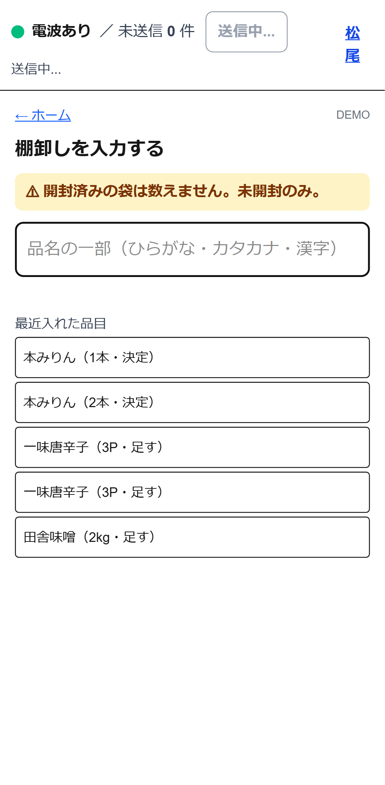
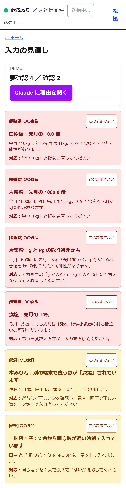

# 棚卸しアシスタント

旅館の調理場で働く料理人が、自分の現場の困りごとのために Claude Code で作った Web アプリ。

調理場の月末棚卸しを、**電波の入らない保管庫の中でもスマホで入力**でき、今の用紙と同じ形で自動集計し、戻ってから **おかしい数字をアプリが見つけ、Claude が「なぜ間違いか」と「どう直すか」を 1〜2 文で説明**する。

Built with Claude: Japan 2026（Anthropic 公式ハッカソン）応募作品。

公開版：https://tanaoroshi-theta.vercel.app

## 試し方（3 行）

1. 公開版を開く → 右上の **『名前を入れる』** を押し、名前を 1 つ選ぶ（デモ用の 松尾／田中／佐藤 で OK）
2. 下の **『設定』** → **『デモ用の今月入力を作る（DEMO 月に切替）』** を押す（わざと間違いを含んだ入力が入る）
3. **『見直し』** で Claude の指摘を見る → **『集計を出す』** で業者ごとの表と金額を見る

## 画面（架空データ）

| 入力（保管庫で） | 見直し（Claude） | 集計（業者ごと） |
|:---:|:---:|:---:|
|  |  |  |

実在の業者名・商品名・人名は含まない。業者は 〇〇食品／△△青果／□□鮮魚／◇◇乾物、品名は 田舎味噌／白砂糖／片栗粉／食塩／本みりん／一味唐辛子 など一般名、人名は デモ用の 松尾／田中／佐藤 のみ。

## 3 分で分かる使いどころ

1. 月末、調理場で全員 2 時間、棚卸し。保管庫（冷凍庫など）は電波が入らない。14 社・約 200 品目の用紙を**めくって探して書き写す**。
2. このアプリはスマホの中（IndexedDB）に 1 件ずつ保存するので、**保管庫では完全オフラインで入力できる**。「みそ」と打つだけで候補が出る。
3. 保管庫から戻って電波が戻ると、**自動でサーバー（Supabase）に送信**。他の端末の分も合算される。
4. 戻ってから **Claude が「0 を 1 つ多く入れた可能性」「kg と g の取り違えかも」などを理由つきで指摘**。要確認・確認で色分け。
5. 集計は**今使っている「調理棚卸表」と同じ形**（業者ごと・品名／数量＋単位／単価／金額）で、印刷・CSV に出せる。

## 主な機能

| 機能 | 中身 |
|---|---|
| オフライン入力 | PWA（Service Worker 全画面プリキャッシュ）＋ IndexedDB。機内モードでも検索・入力・保存ができる |
| 全員分の合流 | 電波が戻ると自動で Supabase に送受信。`client_uid` で二重登録防止、`stocktakes.month` で全端末が同じ棚卸しを共有、`items.supplier_id+name` と `suppliers.name` で upsert、入力記録は 1 件ずつ送って部分失敗に強い |
| 「決定」と「足す」 | `set`／`add` の 2 種類で、別の場所で同じ品目を見つけたときは `add` で加算。合計は「最後の set 以降の add の和」で算出 |
| Claude の見直し | 前月比 10 倍以上、kg/g の約 1000 倍差、2 台から近い時刻の同じ `add`、別端末からの違う `set`、未入力一覧をコード側で検出し、Claude Haiku 4.5 が理由と直し方を日本語 1〜2 文で返す |
| 用紙の写真から品目を一括登録 | 業者ごとの手書き用紙を撮って、Claude Sonnet 4.6（Vision）が業者名・品名・単位・読み（ひらがな）・先月数量・順番を抽出。読みに自信がないときは `needs_check` を付け、UI で黄色強調 |
| 段ボールラベル写真の照合 | 保管庫で撮った段ボールのラベルを、既存品目と照らし合わせて「同じ品目」か「新規の下書き」かを提案 |
| 業者ごとの出力 | 今の用紙と同じ列・同じ品目順。印刷は A4 縦で業者ごとに改ページ。CSV も出す。税込／税抜は設定で切り替え、合計の表示だけが変わる |
| 月の確定 | 確定するとその月の数量が、次の月の「先月の数量」として残る（Claude の見直しに使う） |

## 保管庫で動かすしくみ

- **Service Worker プリキャッシュ**：インストール時に全 14 画面と `_next/static/*` を一括キャッシュ。一度も開いていない画面でも電波なしで開ける
- **IndexedDB（Dexie v7）**：入力は 1 件ずつ保存。合計は「最後の `set` 以降の `add` の和」
- **自動送信**：オンライン復帰で発火、失敗時は 3 / 10 / 30 / 60 秒のだんだん長くする再試行、画面復帰（`visibilitychange`／`focus`）でも未送信があれば送る
- **棚卸しの共有**：サーバー側の `stocktakes` は `UNIQUE(month)`。各端末がそれぞれローカルで `ensureCurrentStocktake` しても、`syncStocktake` が月で突き合わせ、全端末が同じサーバー行を共有
- **写真の縮小**：ブラウザ内で長辺 2000px の JPEG（品質 0.8）に落としてから送るので、Vercel の 4.5MB 上限を越えない。1 枚ずつ送信して失敗の切り分けも容易

## Claude の使いどころ

| 場面 | モデル | 中身 |
|---|---|---|
| 入力の見直し | `claude-haiku-4-5` | コードが検出した指摘ごとに、理由と直し方を 1〜2 文で |
| 用紙の一括登録 | `claude-sonnet-4-6` | 手書き用紙から業者名・品名・単位・読み・先月数量・順番を抽出。慣用読みを優先、不確かな読みは `needs_check` |
| ラベル写真の照合 | `claude-sonnet-4-6` | 段ボールのラベルを既存品目と照らし合わせ |
| 読みの一括作成 | `claude-haiku-4-5` | 品名からひらがな読みを生成 |

API キーは**サーバー側（Next.js API ルート）だけ**で使い、画面側や GitHub には出さない。応答は JSON のみ受け、**人が確認してから反映**する。

## 技術構成

- Next.js 16（App Router・TypeScript・Turbopack）＋ Tailwind CSS 4
- IndexedDB は Dexie 4（スキーマ v7）
- Supabase（Postgres）、ログインなしの運用（匿名 RLS）
- Claude API はサーバー側から `fetch` で直接呼ぶ。`maxDuration = 60`
- テスト：Vitest **139 件**（純粋ロジック）＋ Playwright **47 件**（chromium + webkit の両方で走る合計。chromium 38＋webkit 9。webkit の 2 端末同期系は timing 不安定で `test.skip` 30 件、`offline-clears-sync-msg` 1 件も manual check で skip。全画面エラーなし確認・2 端末合流・画像縮小・バックアップ再現・オフライン→送信・IME 変換中 Enter など）

## 画面

ホーム・使い方・棚卸しを入力する・入力の進み具合・見直し（Claude）・段ボールのラベル写真・集計を出す・用紙の写真から品目を読み込む・今月の品目・設定・品目／発注先の管理・ファイルから品目を読み込む・デモ用紙（14 画面）。

## セットアップ

```sh
cd tanaoroshi
npm install
npm run dev
# http://localhost:3000
```

必要な環境変数（`.env.local`）：

```
NEXT_PUBLIC_SUPABASE_URL=...
NEXT_PUBLIC_SUPABASE_ANON_KEY=...
ANTHROPIC_API_KEY=...
# 任意
ANTHROPIC_MODEL=claude-haiku-4-5
ANTHROPIC_MODEL_VISION=claude-sonnet-4-6
```

Supabase 側は `supabase/schema.sql` と `supabase/members.sql` を SQL Editor で実行。
テーブル：`suppliers / items / stocktakes / count_entries / label_photos / review_findings / members`。
ログイン無しの運用のため、匿名（anon）に全操作を許可する RLS。

## テスト

```sh
npm test        # Vitest（純粋ロジック）
npx playwright test  # E2E
```

## データの守り方と、今の限界

- Supabase の anon キーは画面側に出るが、`.env.local` と Vercel の環境変数で管理し、**ログインを作らない前提**の運用（現場利用者のみが URL を知る）
- Claude API キーは**サーバー側だけ**で使い、画面側コードや GitHub に出さない
- 用紙写真・ラベル写真は端末内に保存し、Claude には画像のみ送って保存はしない
- **ログインが無いため、URL とキーが漏れた場合は誰でも書き込めてしまう**（審査提出時点の限界）。本番運用には Supabase Auth ＋ RLS ポリシーの導入が別途必要
- 実在の取引先名・商品名は含めない。デモデータは架空（`src/lib/demoData.ts`）

## 開発期間

- **最初のコミット**：2026-11-02 13:19:53 +0900（`e9b451d` chore: init Next.js project）
- **最新のコミット**：2026-11-05 12:35:24 +0900（`f341cc6` fix(sync): DEMO 月は stocktake と count_entries をサーバーに同期しない）
  - ※ README／テスト件数などの細かい修正は 2026-11-06 にもコミット中
- **コミット数**：72 件
- **作業日**：2026-11-02（キックオフ）／ 11-03 ／ 11-04 ／ 11-05 ／ 11-06
- **すべてハッカソン期間中（2026-11-02 12:00 開始）に新規作成**。既存のプロジェクトからの持ち込みコード・流用なし。`git log --reverse --format="%ai %h %s" | head` で確認可能

## ハッカソンのルール（守っている点）

- 期間中（11/2 以降）に新しく書いたコードのみ
- Streamlit は不使用
- 画像解析ツールではなく、棚卸しの作業の流れが主役
- 実在の業者名・商品名は使わない（デモは架空）
