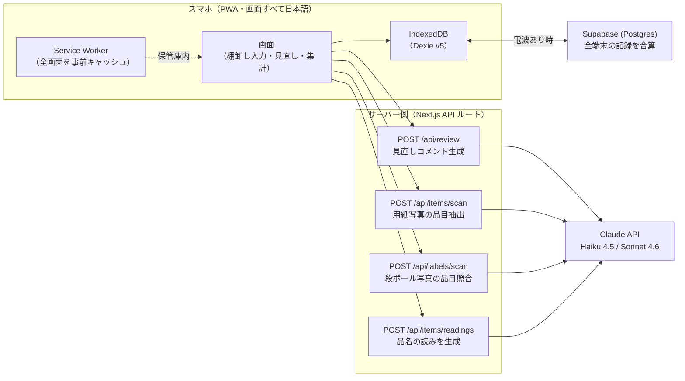
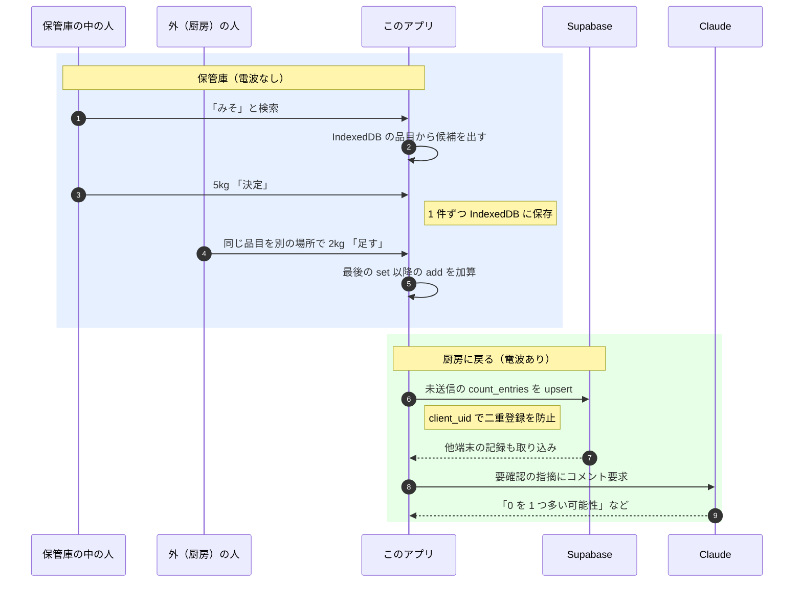

# 棚卸しアシスタント

調理場の月末棚卸しを、電波の入らない保管庫の中でもスマホで入力でき、今の用紙と同じ形で自動集計し、戻ってから Claude が入力の見直しをしてくれる Web アプリ。

Built with Claude: Japan 2026（Anthropic 公式ハッカソン）応募作品。

## 全体像



## 現場での流れ



---

## 解決したい課題

毎月末の昼、調理場の社員 5〜6 人が約 2 時間、調理の手を止めて棚卸しをしている。

- 1 人が保管庫（冷凍庫など）に入って棚に置いてある順に読み上げる
- 外の人が業者ごとの紙の用紙から該当の品目を**探して**書き写す
- 保管庫は電波が入らない
- 単価と金額は料理長が後で手書き
- 聞き間違い・書き間違い・写し間違いが起きやすく、発注ミスにつながる

このアプリは、保管庫の中で完全オフラインで入力でき、戻ったら Claude が「0 を 1 つ多く入れた可能性があります」のような見直しコメントをくれる。出力は今使っている「調理棚卸表」と同じ形で、業者ごと・品名／数量＋単位／単価／金額の表に自動で並ぶ。

## 使い方（現場の流れ）

1. **始める前**（厨房・事務所／電波あり）：ホームからアプリを開き、品目データを端末に読み込む。「ホーム画面に追加」でアイコン化しておくと、電波がなくても開ける
2. **保管庫の中**（電波なし）：
   - 検索欄に「みそ」などと打つと候補が出る → 大きなボタンでタップ
   - 数量を入力して「この数で決定」「今の数に足す」「なし」のいずれか
   - 別の場所で同じ品目を見つけたら「足す」。合計は自動で計算
   - kg の品目は小数で入力可。g で入力しても自動で kg に換算
3. **戻ってから**（電波あり）：未送信の入力が自動で Supabase に送られ、全員分が合算される
4. **見直し**：見直し画面で、おかしい数字を Claude が理由つきで指摘。「このままでよい」で非表示に
5. **集計**：集計画面から業者ごとに「調理棚卸表」と同じ形の表を印刷・CSV 出力。単価と金額は自動で入る

## 画面

| 画面 | 役割 |
|---|---|
| ホーム | 入り口。発注先・品目の管理・CSV取込・用紙スキャン・設定への導線 |
| 棚卸しを入力する | 保管庫で使うメイン画面。検索して数量を入れる |
| 入力の進み具合 | 業者ごとの入力済み／未入力。「未入力を全部なし（0）」でまとめて 0 |
| 見直し（Claude） | 前月比・kg/g 取り違え・二重カウント・未入力を指摘、Claude による説明 |
| 集計を出す | 業者ごとに今の用紙と同じ形で印刷・CSV |
| 用紙を撮って登録 | 今の棚卸し用紙を撮って、Claude で業者名・品名・単位・読み・先月の数量を一括登録 |
| CSV取込 | 既存の品目データを一括で取り込む |
| 設定 | 税込/税抜・税率、月の切替・新規作成、名前の一覧 |
| 発注先／品目 | 個別の CRUD |
| デモ用紙 | 架空の調理棚卸表を印刷（用紙スキャンのデモ撮影用） |

## Claude の使いどころ

| 場面 | 使い方 | モデル |
|---|---|---|
| 入力の見直し | 前月比較・kg/g 取り違え・二重カウント・未入力の指摘を、理由つきで日本語 1〜2 文に | `claude-haiku-4-5-20251001` |
| 用紙の一括登録 | 業者ごとの用紙（手書きあり）を撮って、業者名・品名・単位・読み（ひらがな）・先月の数量・順番を抽出 | `claude-sonnet-4-6`（Vision） |

API キーは**サーバー側（Next.js の API ルート）からのみ**使う。画面側のコードや GitHub には出さない（環境変数で管理）。
Claude の応答は JSON で受け取り、人が確認してから反映する。

## 保管庫で動かすしくみ

- 入力データは**端末の中（IndexedDB）に 1 件ずつ保存**。送信はあとで
- 画面は PWA 化。**Service Worker のインストール時に全画面の HTML と参照する JS/CSS を一括でキャッシュ**するので、一度も開いていない画面でも電波なしで開ける
- 画面上部に「電波あり／なし」と「未送信 N 件」を常に表示
- 電波が戻ると自動で送信、Supabase 側で全員分を合算
- 送信済みレコードは `client_uid` で二重登録を防止
- 同じ品目が複数人・複数台で入ってきた場合は「決定」と「足す」の合計規則で判定（最後の set 以降の add の和）
- 発注先・品目は `upsert(onConflict=name)` / `upsert(onConflict=supplier_id,name)` で送るので、**何台から何回送っても重複エラーにならない**
- 入力記録は 1 件ずつ送るので、1 件が失敗しても他は送られ、失敗分は次回自動で再送される

## データの守り方と、今の限界

- Supabase の anon キーは画面側に出るが、`.env.local` と Vercel の環境変数で管理し、ログインを作らない前提の運用（現場利用者のみが URL を知る）
- Claude API キーは**サーバー側（Next.js API ルート）だけ**で使い、画面側コードや GitHub に出さない
- 用紙写真・ラベル写真は端末内（IndexedDB）に保存し、Claude には画像のみ送って保存はしない
- **ログインが無いため、URL とキーが漏れた場合は誰でも書き込めてしまう**（審査提出時点の限界）。本番運用には、Supabase Auth ＋ RLS ポリシーの導入が別途必要
- IndexedDB は端末単位のため、端末を替えるときは設定の「書き出す／読み込む」でバックアップを使う
- 実在の取引先名・商品名は含めない。デモデータは架空（`src/lib/demoData.ts`）

## 技術構成

| 項目 | 使うもの |
|---|---|
| 形 | スマホのブラウザで使う Web アプリ（PWA、画面はすべて日本語） |
| フレームワーク | Next.js 16（App Router、TypeScript、Turbopack） |
| スタイル | Tailwind CSS 4 |
| 端末内の保存 | IndexedDB（Dexie 4） |
| サーバー保存 | Supabase（Postgres） |
| 公開 | Vercel |
| Claude API | サーバー側の Next.js API ルートから fetch で直接呼ぶ |
| テスト | Vitest |

## セットアップ

```sh
cd tanaoroshi
npm install
npm run dev
# http://localhost:3000
```

必要な環境変数（`.env.local`）：

```
NEXT_PUBLIC_SUPABASE_URL=...
NEXT_PUBLIC_SUPABASE_ANON_KEY=...
ANTHROPIC_API_KEY=...
# 任意
ANTHROPIC_MODEL=claude-haiku-4-5-20251001
ANTHROPIC_MODEL_VISION=claude-sonnet-4-6
```

Supabase 側は `supabase/schema.sql` を SQL Editor で実行。
テーブル：`suppliers / items / stocktakes / count_entries / label_photos / review_findings`。
ログイン無しの運用のため、匿名（anon）に全操作を許可する RLS。

## テスト

```sh
npm test
```

純粋ロジック（合計計算・単位換算・税計算・見直し判定）を Vitest で検証。

## ハッカソンのルール（守っている点）

- 期間中（11/2 以降）に新しく書いたコードだけ
- Streamlit は使っていない
- 画像解析ツールではなく、棚卸しの作業の流れが主役
- 実在の業者名・商品名は使わない（デモは架空のデータ）

## リポジトリの構成

```
tanaoroshi/
├ src/
│  ├ app/        … 画面と API ルート
│  ├ components/ … StatusBar / PwaRegister
│  └ lib/        … db / sync / supabase / findings / qty / tax / units / search
├ public/        … アイコン、manifest、Service Worker
├ supabase/
│  └ schema.sql  … Postgres のテーブル定義
├ tests/         … Vitest
└ README.md
```
